  

  Создаю надёжные fullstack-решения на <b>Java</b> и <b>TypeScript</b>. 
  Выстраиваю архитектуру приложений с нуля, проектирую интерфейсы в <b>Figma</b> 
  и автоматизирую сложные процессы.

 

<h3 align="center">Стек</h3>

   
  

 

<h3 align="center">Проекты</h3>

<table align="center">
  <tr>
    <td width="50%" valign="top">
      <h4>🔥 <a href="https://github.com/chipichapus-chipi-chapa/Ogonek-A-Collection-of-Games-for-Camp-Counselors">Огонёк</a></h4>
      Офлайн-сборник игр для вожатых по заказу СПО «Маэстро» РГПУ им. Герцена: подборки по возрасту и активности, избранное, свои статьи.
        
      
      
      
    </td>
    <td width="50%" valign="top">
      <h4>🎵 <a href="https://github.com/chipichapus-chipi-chapa/Octave">Octave</a></h4>
      Бронирование для музыкальной студии: залы, аренда инструментов, курсы. Пересечение тайм-слотов, сетка расписания, личные кабинеты.
        
      
      
      
    </td>
  </tr>
  <tr>
    <td width="50%" valign="top">
      <h4>💧 <a href="https://github.com/chipichapus-chipi-chapa/waterfall">Waterfall</a></h4>
      Покупка билетов на водопады с автоматизацией документооборота: персональный PDF-билет собирается по шаблону.
        
      
      
    </td>
    <td width="50%" valign="top">
      <h4>🐎 <a href="https://github.com/chipichapus-chipi-chapa/horse-camp">Horse Camp</a></h4>
      Информационная система для конных скачек: проектирование БД, большой массив динамических данных, фильтрация и отчёты.
        
      
      
    </td>
  </tr>
</table>
